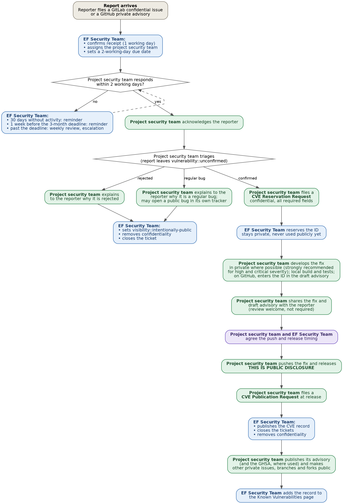

# Vulnerability Handling for Eclipse Committers and Project Leads

This page explains what to do when someone reports a security vulnerability in an Eclipse Foundation project.

The EF Security Team is available to help at any point: <security@eclipse-foundation.org>.

## Background

Eclipse Foundation (EF) projects develop in public; vulnerabilities, however, should be fixed privately. This is strongly recommended for high and critical severity vulnerabilities. Whichever way the fix is developed, timing is what matters:

**The moment a fix lands on a public branch, the vulnerability is considered publicly disclosed**, even without a release and even if the commit message says nothing about security. Security fixes are routinely identified from commit history by automated tooling. Keep the public commit, the release and the advisory as close together in time as possible.

**A CVE ID is an identifier for a specific vulnerability in a specific product.** It serves two purposes:

- Before publication, it gives the people who know about the issue something concrete to refer to when discussing it.
- After publication, it is what lets users be notified by their vulnerability scanners about vulnerabilities in their dependencies or in the applications they run.

Two consequences follow:

- Request the CVE ID before the fix is pushed, not after, and not at release time.
- Tell the EF Security Team when the fix is released, by opening a CVE Publication Request. The CVE is published alongside a release, not alongside the commit, so that adopters have something to upgrade to.

(whos-involved)=
## Who's involved

**Reporter:** whoever found the issue. May be an external researcher, a downstream user, another EF project, or the EF Security Team itself.

**Project Security Team:** the project's own committers who handle vulnerability reports for that project. By default this is all of the project's committers. A project can instead elect a separate, smaller team through its Project Management Committee (see the [Project Handbook](https://www.eclipse.org/projects/handbook/#projects-security-team)). Membership is managed in the Project Management Infrastructure (PMI), and every member needs a gitlab.eclipse.org account. Every member is assigned to every report and there is no opt-out, so large projects should define a dedicated team rather than leave it at the default. Any member can act on any report; there is no need to wait for someone else to pick it up.

**EF Security Team:** the Eclipse Foundation's security staff ([team page](https://www.eclipse.org/security/team/)). Triages incoming reports, routes them, operates the Foundation's CNA, and publishes CVE records. Reachable at <security@eclipse-foundation.org>.

**EMO:** the [Eclipse Management Organisation](https://www.eclipse.org/projects/handbook/#roles-emo). Involved in the projects' lifecycle.

## TL;DR

The detailed version can be found in [The process](#the-process) below.

1. **Receive:** the reporter files confidentially; the EF Security Team confirms within 1 working day and assigns the report to the corresponding project security team. The project security team responds and acknowledges the reporter.
2. **Assess:** the project security team classifies the report as confirmed, regular bug, or rejected. The report cannot be closed until one is chosen. If it is not a vulnerability, the EF Security Team lifts confidentiality and closes it; the process stops there.
3. **Reserve:** the project security team files a CVE Reservation Request as soon as the issue is confirmed; it must exist before the fix is pushed. This does not happen automatically and the EF Security Team cannot open it on the project's behalf.
4. **Patch:** the project security team develops the fix, in private where possible and in any case for high and critical severity. The fix is not pushed before it can be released.
5. **Push and Release:** the push is the public disclosure, so push, release and advisory should be kept as close together as possible. The CVE Publication Request is filed at release or just after.
6. **Publish:** the EF Security Team publishes the CVE record, closes the tickets and lifts confidentiality. The project security team publishes its advisory.

## The process at a glance

## Skip the queue

Contact the EF Security Team directly, by email as well as in the ticket, in any of these cases rather than waiting on the normal cadence:

- **Suspected active exploitation.** As an open source steward under the EU Cyber Resilience Act, the Eclipse Foundation has to report actively exploited vulnerabilities to the EU Single Reporting Platform (SRP), starting 11 December 2027, on much shorter clocks than the process below. The Foundation cannot meet that obligation if it learns late, so tell the EF Security Team as soon as exploitation is suspected, even without certainty.
- **Leaked credentials.** Revoke and rotate first. Usually no CVE, because there is no weakness for adopters to patch.
- **Another Eclipse Foundation project is affected.** Do not contact them directly. Coordination happens on a secure channel provided by the EF Security Team (GitLab). See [Best Practices Related to Embargoes](embargoes.md).
- **The reporter is threatening to publish.** Do not negotiate alone.

Each is covered in [Situations that come up](#situations-that-come-up).

## Confidentiality

Keep everything about an undisclosed vulnerability confidential until it is closed as not a vulnerability, or a fix is released and the CVE record has been published. This period is called the **embargo**. Foundation policy limits initial sharing to **the reporter, the project security team, and the EF Security Team**.

**Do not:**

- open a public issue, discussion, or pull request describing the problem;
- discuss it on a public mailing list, Slack, forum, or social media, including the project's own chat;
- reference the security nature of the work in commit messages, release notes, announcements, or a public roadmap while the issue is still embargoed;
- use an assigned CVE ID anywhere public before its record is published: not in a commit message, changelog, release note, or PR title.

**On sharing outside that circle.** Sharing with anyone beyond the reporter, the project security team and the EF Security Team should be transparent: the others are told what is being done. Bringing in a domain expert or looping in another project is announced in the ticket first. An invitation to join a disclosure group is forwarded to the EF Security Team rather than accepted directly.

## The process

Each step is tagged with who acts; see [Who's involved](#whos-involved) above.

### Receive

1. **Reporter:** files through the project's channel: a confidential issue in the [GitLab vulnerability reports tracker](https://gitlab.eclipse.org/security/vulnerability-reports/) or a private GitHub Security Advisory.
2. **EF Security Team:** aims to confirm receipt to the reporter within 1 working day. That confirmation only says the report arrived and that the project is being contacted. It is not an assessment.
3. **EF Security Team:** assigns the project security team to the ticket. If there has been no activity after 30 days, the EF Security Team follows up.
4. **Project security team:** responds to the ticket, ideally within 2 working days. A first response does not need to be an answer; "we have seen this and are looking at it" is enough. What matters is that the reporter and the EF Security Team know the report reached someone on the project side.

   If the project security team does not respond, the EF Security Team's reminders follow the schedule in [Timelines](#timelines).
5. **Project security team:** acknowledges the reporter directly, in the ticket or advisory thread. Reporters who receive no acknowledgement are more likely to publish early; a prompt acknowledgement is the simplest way for a project to avoid an uncoordinated disclosure.

### Assess

6. **Project security team:** gives an explicit triage classification. Every new vulnerability report is created with the label `vulnerability::unconfirmed`. That is not a valid resting state, and the report cannot be closed while it carries that label. It stays there until the project security team decides which of three it is:

   | Assessment | Label |
   |---|---|
   | A security vulnerability | `vulnerability::confirmed` |
   | A regular bug with no security impact | `vulnerability::regular_bug` |
   | Not a vulnerability | `vulnerability::rejected` |

   The project security team states the classification in the ticket; the EF Security Team sets the label. If the project security team is not sure which one applies, it should say so and ask; an uncertain answer is more useful than none.

   This determination, whether a vulnerability exists, belongs to the project security team. The EF Security Team usually concurs with the assessment. If the reporter disagrees with it, the EF Security Team acts as a referee.

   The distinctions that come up most:

   - An **insecure default** is a vulnerability. A **documented, non-default option** that an authorised user changes generally is not.
   - A crash on bad input from a trusted caller is a bug, not a vulnerability. The same crash on input from an untrusted source crosses a trust boundary and is one.
   - A vulnerability **in a dependency** is a vulnerability in the project too: treat it as confirmed and keep it embargoed until the version is bumped. It does not get its own CVE; the advisory references the dependency's existing ID.
   - A vulnerability in an **unsupported or end-of-life version** is still considered a vulnerability and cannot be dismissed on the mere fact that the version is no longer maintained.

   Whether a confirmed vulnerability gets a CVE is a separate question; see [Does this need a CVE?](#does-this-need-a-cve)

   **Duplicate reports.** If a report covers something already reported, say so in the ticket and link the original. The EF Security Team closes the duplicate as a duplicate and **keeps it confidential until the original is disclosed**, because making a duplicate public early would disclose the original vulnerability. One vulnerability gets one CVE, however many times it is reported.

7. **Project security team:** if the report is rejected or classified as a regular bug, tells the reporter why, in the ticket, rather than letting it lapse silently. In both cases the ticket stops being confidential.

   The EF Security Team then sets the label to `visibility::intentionally-public`, removes confidentiality, and closes the ticket. Duplicates are the exception: they are closed but stay confidential.

   For a regular bug, nothing is transferred automatically. If the project wants the issue tracked as an ordinary bug, the project security team opens a bug in its own tracker. That is the project's call.

   This is deliberate. If it is not a vulnerability, there is nothing to embargo, and leaving it confidential hides a decision that should be reviewable. The reasoning in the ticket should therefore be written on the assumption that it will be public. If the ticket contains details that should not be published even though the issue is not a vulnerability, the project security team should say so before the label changes.

8. **Project security team:** if the report is confirmed, tells the reporter a fix is being worked on, and gives a sense of timing if there is one. The next step is to **open a CVE Reservation Request** (step 9) immediately, not once the fix is written. If the project security team believes this report should not get a CVE, see [Does this need a CVE?](#does-this-need-a-cve) and say so in the ticket.

### Reserve the CVE ID

9. **Project security team:** opens the CVE reservation request. This is the project security team's responsibility. The EF Security Team will not open it on the project's behalf, and a confirmed label does not automatically produce a CVE. Nothing happens until the project security team asks.

   There are two tickets, at two different points:

   - [**CVE Reservation Request**](https://gitlab.eclipse.org/security/cve-assignment/-/work_items/new?description_template=CVE%20Reservation%20Request&issue%5Bconfidential%5D=true): opened by the project security team once the vulnerability is confirmed, to reserve the ID and draft the CVE entry.
   - [**CVE Publication Request**](https://gitlab.eclipse.org/security/cve-assignment/-/work_items/new?description_template=CVE%20Publication%20Request&issue%5Bconfidential%5D=true): opened by the project security team at release, linking the release and any advisory. The CVE is published as drafted in the reservation request.

   Open the reservation request **as soon as the issue is confirmed**, not when the fix is ready, and before it is pushed.

   **Make sure the work item is confidential.** The template links above set this, but confirm it before submitting. A CVE request that is publicly visible discloses the vulnerability.

   **Fill in every field unless it is marked optional.** An incomplete request comes back for more information, which costs time the project may not have later:

   | Field | |
   |---|---|
   | Project name | required |
   | Project ID | required |
   | Versions affected | required |
   | CWE | required |
   | CVSS | required |
   | Summary | required |
   | Links | required |
   | Credits | required (see below) |
   | CAPEC | optional, but strongly recommended |

   **Credits.** The reporter is credited by default, by the name they reported under. If the vulnerability was found by the Eclipse Foundation, the credit is **Eclipse Foundation Security Team**. Credit never goes in the CVE record description; that is a CVE program rule. People can additionally be credited in the project advisory. Rediscovery is not credited by default: where an issue has already been reported, credit goes to the first reporter.

   **Link the reservation request to the vulnerability report.**

   **Do not request an ID from an employer's CNA, the reporter's CNA, or any other source.** The Eclipse Foundation is a CNA and is responsible for CVE IDs across all Eclipse Foundation projects. If a reporter says they will get an ID elsewhere, tell the EF Security Team.

   **On GitHub Security Advisories, do not use the green "Request CVE" button.** It routes the request to GitHub's CNA, which makes GitHub the owner of the record instead of the Eclipse Foundation. Request the ID on GitLab using the Reservation Request above, even when the rest of the coordination is happening in the GitHub Security Advisory (GHSA).

10. **EF Security Team:** reserves the ID and posts it as a comment on the reservation ticket. **The reserved ID stays private.** It **must not** appear in any public material before the record is published; doing so breaches the embargo.

    **On GitHub Security Advisories:** once the ID is reserved, the project security team enters it in the draft advisory's CVE identifier field (edit the advisory, choose "I have an existing CVE identifier" and paste the ID). This is done in the draft, before publication: a published advisory without the ID in that field is disconnected from the CVE record, and GitHub will offer to request a CVE from its own CNA. The advisory is not published yet; the draft stays private.

    If the project security team is unsure whether a report needs one CVE or several, it should ask; the EF Security Team can help with that determination. For a multi-project embargo it may be one CVE or one per project, depending on whether the flaw is in shared code; that is decided during the embargo period.

### Patch

11. **Project security team:** develops the fix. Fixing in private is recommended, and strongly recommended for high and critical severity vulnerabilities; see [Developing a fix under embargo](#developing-a-fix-under-embargo) for how to do this on GitHub and on GitLab. If a private build or CI environment is needed, contact the EF Security Team, who will look into the options.

    If the vulnerability is severe and at high risk of rapid exploitation, do not create tickets about it anywhere, not on GitHub or GitLab and not even in a private fork. Ask the EF Security Team when unsure how far to go.

12. **Project security team:** writes an advisory. This is recommended rather than strictly required.

    If writing one: give adopters what is affected, which versions, the impact, what to upgrade to, and any workaround or mitigation. Do not include reproduction steps or exploit code. See [Security Advisories](advisories.md).

    Note that **the CVE record and the GitHub advisory are different artifacts** with different content requirements.

13. **Project security team:** shares the fix and any draft advisory with the reporter before publishing, and gives them a chance to comment, where possible. Their review is welcome, since it gives everyone more confidence in the fix, but it is not required: the release does not wait for the reporter's approval. The reporter is credited either way (see the Credits section under step 9). Agree on timing with the EF Security Team if necessary.

### Push and Release

14. **Project security team:** pushes the fix and releases. Include the fix in a release where possible. In a multi-project embargo, all affected projects release on the same date or shortly after. For anything significant, consider a pre-advisory: announce on a predictable channel, a few days ahead and no more than a week, that the next release will contain security fixes. Give the release date and rough severity, and nothing else: no affected component, no description, no CVE ID. That lets adopters schedule an upgrade window without telling anyone where to look. Publish the full details, the CVE and the release together on the day.

15. **Project security team:** files the CVE Publication Request linking the release and any advisory. This work item is kept confidential too.

    **File it at release.** The push already disclosed the vulnerability, so the gap between push and release is a window where the issue is public with nothing to upgrade to; keep it short. The Publication Request is the trigger: the EF Security Team does not publish the CVE record until it is filed.

(publish)=
### Publish

16. **EF Security Team:** on receiving the Publication Request, publishes the CVE record, closes the tickets, and removes confidentiality from them. The now-public ticket serves as the public reference the CVE record requires. Credits are as recorded at step 9.

    **Where the project uses a GitHub Security Advisory (GHSA):** the EF Security Team publishes the CVE record with the advisory URL in its references, then comments on the Publication Request that the advisory can go public. The project security team then publishes the GHSA. The EF Security Team does not publish or edit the advisory: the comment thread holds context that must be moved into the body first, and only the project can judge what belongs there.

17. **Project security team:** publishes the advisory, if one was written, through the project's normal channels, and makes any other previously private issues, branches, or forks public at the same time.

18. **Project security team**, on GitHub Security Advisories: published advisories show only the advisory body, not the comment thread. **Move anything worth keeping from the comments into the body before publishing**, as the thread stays private and will not appear in the published advisory.

19. **EF Security Team:** adds the record to the [Eclipse Known Vulnerabilities](https://www.eclipse.org/security/known/) page.

20. **Project security team:** updates the project's security page and makes sure it is linked from somewhere findable.

## Timelines

| Time since report | What happens |
|---|---|
| Within 1 working day | EF Security Team confirms receipt and assigns the project security team |
| Within 2 working days | The project security team's first response is due |
| 30 days | The EF Security Team follows up if there has been no activity |
| 1 week before the deadline | The EF Security Team sends a reminder that the deadline is approaching. If the fix will not be released in time, the project security team says so in the ticket and proposes a new date |
| 3 months | **Foundation policy expects the vulnerability to be resolved.** Extensions may be granted by the EF Security Team |
| After the deadline | The EF Security Team posts a reminder that the deadline has passed. Overdue reports are reviewed weekly by the EF Security Team and escalated per project through the Project Leadership Chain |
| At release | Project security team files the CVE Publication Request; EF Security Team publishes the record, closes the tickets, and lifts confidentiality |

What "resolved" means under the [Eclipse Foundation Security Policy](https://www.eclipse.org/security/policy/): a fix or a workaround is available, or it has been determined that a fix is not possible or desirable, in which case **a risk analysis must be provided**. Running out of time is not a resolution; a risk analysis is.

If three months is not going to be enough, ask for an extension rather than going quiet.

Reminders are automated comments on the report that mention the project security team and the reporter. They stop when the report is closed; an extension moves the deadline and the reminders with it.

## Situations that come up

**"We can't fix it; nobody's maintaining that part any more."** Say so early. Under the Security Policy this is a legitimate resolution, but only with a **risk analysis** explaining why a fix is not possible or desirable and what the exposure is. The vulnerability is still disclosed and still gets a CVE. What changes is the advisory: it tells adopters there is no fix and what to do instead, which is information they need.

**"We'd rather not have a CVE at all."** That option does not exist, and declining removes the project's control over the record rather than protecting it. Once the issue is public, the CVE program requires a higher-level CNA to step in and assign within a short window. The record is then written by someone with no knowledge of the code, and correcting the description, affected versions or references means going through whoever owns it, or asking for a transfer first. Both are slow. **Having the Foundation assign it is the option that keeps the project in control of the narrative.**

**"I have never written a CVE record and do not know how."** No security expertise is needed, only the technical details: affected versions, root cause, and any mitigations. That usually means whoever wrote or reviewed the fix, even if the report landed on someone else; ask them to fill in the request. The EF Security Team reviews and flags gaps, but the content comes from the project.

**"The reporter is threatening to go public."** Tell the EF Security Team immediately. Do not negotiate alone.

**"It's a leaked credential, not a code bug."** This follows a different path: revoke and rotate first, then assess whether any code or artifact was tampered with. Exposed secrets usually do not get a CVE, because there is no weakness in the code for adopters to patch. Contact the EF Security Team straight away, especially if Foundation infrastructure, signing keys, or publishing credentials are involved.

**"We think this is being actively exploited."** Tell the EF Security Team immediately, by email as well as in the ticket, and say so explicitly. Known exploitation changes the Foundation's obligations, including under the EU Cyber Resilience Act, and those run on much shorter clocks than the process above.

**"Another project is affected too."** Tell the EF Security Team rather than contacting the other project directly. Multi-project embargoes need synchronised release dates, sometimes a common advisory, and a decision on whether it is one CVE or several. The Foundation coordinates these; see [Best Practices Related to Embargoes](embargoes.md).

**"Someone else already assigned a CVE for this."** Tell the EF Security Team, whether it was GitHub's CNA via a GHSA, a reporter's employer, a distribution, or MITRE. In most cases the Foundation can ask for ownership to be transferred, since it has the most appropriate scope. Do not try to arrange this directly.

(developing-a-fix-under-embargo)=
## Developing a fix under embargo

Fixing in private is recommended, and strongly recommended for high and critical severity vulnerabilities. Where possible, nothing about the fix reaches a public branch until the release is ready: the push is the disclosure.

**Neutral commit messages.** Commit messages, branch names and pull request titles say what the change does, not why. No "vulnerability", "security fix", "exploit" or "CVE", and never the reserved CVE ID. The branch will be public the moment it is pushed, and commit history is scanned for security fixes; a neutral message does not hide the fix, but it does not advertise it either. The fix is described in the advisory and in the CVE record instead.

### On GitHub: use the advisory's temporary private fork

1. **Start from a draft GitHub Security Advisory on the repository.** If the report arrived through the GitLab tracker rather than as an advisory, create a draft advisory. Only users with a [security manager role](https://otterdog.readthedocs.io/en/latest/userguide/guides/repository-security/#organization-settings-related-to-security) (or repository admin rights) can create one; this role is not enabled by default, and the project security team can be added as security managers in the Otterdog configuration through a self-service pull request. The repository's private vulnerability reporting setting only controls whether outsiders can file reports and is not needed for this. Projects that want external reporting can enable it through the [Otterdog self-service configuration](https://otterdog.readthedocs.io/en/latest/userguide/guides/repository-security/#private-vulnerability-reporting).
2. **Create the temporary private fork from the advisory.** Only the advisory's collaborators can see it. Add the people who will work on the fix as collaborators on the advisory.
3. **Develop and review in the fork.** Pull requests inside the fork are reviewed by the advisory's collaborators like any other.
4. **CI does not run.** GitHub Actions do not execute in temporary private forks, and no Eclipse-hosted CI can see them. Build and run the tests locally, and note in the advisory that this was done.
5. **The ECA and Otterdog checks never complete in the fork either**, and branch protection rules that require them block the advisory's merge button. Until that is resolved, the workaround is: on the agreed release day, push the same branch to the upstream repository as an ordinary pull request, with neutral commit messages, let the checks pass, and merge. That push is the public disclosure, so it happens at release, not before. Close the pull request in the private fork; GitHub removes the fork once the advisory is published.
6. **Enter the reserved CVE ID in the advisory** (step 10) and publish the advisory only when the EF Security Team confirms the CVE record is live (step 16).

### On GitLab (gitlab.eclipse.org)

Private repositories and private forks are not available on the Foundation's instance, and GitLab CI only runs on what it can see. Develop on a local branch, build and test locally, and push at release. If a private environment is needed for a particular fix, open a [Help Desk](https://gitlab.eclipse.org/eclipsefdn/helpdesk/-/issues/new) issue; the EF Security Team and the Infrastructure team will look at options case by case.

### On both

- Never put the embargoed branch through the project's public pipeline, not even for a test run.
- Prepare backports for all supported branches in the same private place, so that they ship together.

## Does this need a CVE?

Short answer: **if it is a confirmed vulnerability, yes**. The default is to assign. If there is real doubt, the EF Security Team reserves an ID anyway; a reserved ID can be rejected later.

### Why a CVE is worth having

A CVE ID is how adopters learn that a vulnerability was found in a project and that they need to act: upgrade, mitigate, or assess exposure. It is what dependency scanners match against, what SBOM tooling resolves, and what a downstream user's security process keys on. Without one, someone consuming the project has no mechanical way to learn they are affected; they would have to read the commit log.

CVE counts track whether a project has a working security process, not whether its code is bad. A project with no CVEs is more often one that nobody has examined than one without vulnerabilities, and experienced adopters read it that way.

### Who decides what

The **project security team** decides whether a vulnerability exists. It knows the code, and the Foundation, as CNA, accepts that determination.

The **EF Security Team** handles the CVE side: whether an ID is assigned, how many, and making sure the record meets the CVE program's requirements. That is the Foundation's responsibility as a CNA, so it is not a burden the project has to carry alone; but it does mean "we would rather not have a CVE for this" is a conversation rather than a decision. A project that thinks one is not warranted should say so with its reasoning, and the EF Security Team will work it out with the project.

### Quick reference: does it get a CVE?

| Situation | Vulnerability? | CVE? |
|---|---|---|
| No security impact: a bug that does not cross a trust boundary | no | no |
| A documented non-default option changed by an authorised user | no | no |
| A vulnerability only in a dependency, fixed by bumping a version | yes, in the dependency | the dependency's CVE, not a new one |
| Being end-of-life, in itself | no | no |
| Code that was never publicly available | — | no |
| Deliberately vulnerable teaching or test code | — | no |
| Leaked credentials, where nothing was tampered with | — | usually no; see [Situations that come up](#situations-that-come-up) |
| A duplicate of an existing report | — | the original's CVE |
| An insecure default | **yes** | **yes** |
| Unreleased code with no published artifact ever | — | usually no; see [Edge cases](#edge-cases) |

### Edge cases

**"It only affects unreleased code."** If the vulnerable code was never in a release, a published snapshot or any other public artifact, no CVE is needed; the EF Security Team records why in the ticket. If it was in snapshots or nightlies the project published, even ones it has since stopped publishing, say so: those count as released, and a CVE is assigned.

**"We have no tagged releases; we commit straight to main."** It is still possible to identify affected code by commit or date, so this does not prevent a CVE. But tell the EF Security Team what adopters actually consume: a published artifact, a branch, a tag. If adopters have no released version to upgrade to, that is a problem worth solving independently of this report; a CVE that does not point to a fixed version is of little use to adopters.

**"The project is archived."** Archived and end-of-life versions still get CVEs, tagged to show they are unsupported. The tag states exactly what the project wants adopters to know, that no fix is coming; declining a CVE states nothing. If a supported version is affected too, it is one CVE covering both, not two.

**"Nobody uses this."** Adoption does not define whether a vulnerability exists. If artifacts are publicly published, they are consumable by anyone, and a project cannot know all of its consumers.

**"It only triggers with a malicious server, peer, or broker."** That is a trust boundary being crossed, not a reason to decline. A remote peer is untrusted input, and handling malformed input safely is what a parser is for. Requiring well-formed input before it counts means the code is only obliged to be safe against inputs that were never the threat. If the project's threat model genuinely places the peer inside the trust boundary, say so and point the EF Security Team at it. That is a real argument, but it needs to be written down rather than assumed.

**"There's no fix yet."** Assignment attaches to the vulnerability, not the fix. Reserve the ID now; publication happens at release.

**"We're not sure if it's one issue or several."** Ask. If two issues cannot be fixed independently, it is one CVE. If the same flawed code affects several Eclipse Foundation projects, it is still one CVE.

**"Nobody has actually exploited this."** The test is whether a trust boundary can be crossed with security impact, not whether someone has built a working exploit or observed one in the wild. A demonstrated proof of concept makes assessment easier and usually raises severity, but its absence is not a reason to decline. Weak cryptography, missing validation, and unsafe defaults are vulnerabilities on the same basis whether or not anyone has attacked them yet.

### Disagreements

Raise them in the ticket, with the reasoning. Most disagreements come down to the threat model, meaning what the code treats as trusted. If the project has one written down, link it; if not, writing one is the most effective way to shorten these discussions.

If a published record about a project is wrong (incorrect affected versions, a misleading description, a bad reference), contact the EF Security Team. The Eclipse Foundation owns the record and can correct it. This applies after publication too; a published CVE is not fixed in stone.

## Common mistakes

- Letting the gap between pushing the fix and releasing it stretch out. The push already disclosed it.
- Waiting until the fix is ready to reserve the CVE ID. Reserve at step 9.
- Using the reserved CVE ID in a commit message, changelog, or release note before publication.
- Releasing the fix without filing the Publication Request.
- Requesting a CVE through GHSA's green "Request CVE" button, an employer's CNA, or the reporter's CNA.
- Publishing a GitHub Security Advisory without the reserved CVE ID in its identifier field, or before the EF Security Team has published the CVE record.
- Opening a CVE request that is not confidential.
- Assuming a `vulnerability::confirmed` label produces a CVE by itself.
- Assuming a dependency bump needs its own CVE. It does not; reference the dependency's existing ID.
- Listing someone on the project security team who has no gitlab.eclipse.org account.

## Before the next report: be ready

Six things to have in place now, not when a report arrives.

1. **Decide who the project security team is**, and keep it current as committers join and leave. The EF Security Team routes reports by assigning that security team to the ticket. If it is stale, or a large project has been left on the all-committers default, the report sits unassigned while someone works out who to ask; and if a researcher cannot find a contact, a project may learn about a multi-project embargo late or not at all.
2. **Every member of the project security team needs a GitLab account on gitlab.eclipse.org.** Confidential issues in the vulnerability reports tracker and CVE requests can only be assigned to, and read by, GitLab users. A security team member without an account cannot be assigned, cannot see the reports, and effectively is not on the team. Check this when people are elected to the role, not when the first report arrives. Getting an account is quick: log in to gitlab.eclipse.org once with an Eclipse account.
3. **Maintain an updated SECURITY.md.** It is the file reporters look for, and it is what makes a project's security contact publicly findable. The Eclipse Security Handbook provides a [template](https://github.com/eclipse-csi/security-handbook/blob/main/templates/SECURITY.md). If a project is archived, say so there.
4. **Maintain a threat model.** Know what the project is protecting, where its trust boundaries are, how an attacker could reach sensitive assets, and which dependencies or deployment assumptions matter to security. Keep the model lightweight, but revisit it when the architecture, exposed interfaces, dependencies, or intended use changes. A current threat model makes it much easier to assess whether a reported issue is actually exploitable and what else may be affected.
5. **Know which channel the project uses**: a confidential issue in the GitLab vulnerability reports tracker or a private GitHub Security Advisory on the repository. Confirm which one applies and make sure SECURITY.md agrees.
6. **Make sure more than one person watches the channel.** A single point of contact who goes on holiday is the most common cause of a missed notification.

## Getting help

- EF Security Team: <security@eclipse-foundation.org>
- Report a vulnerability: [New Vulnerability template](https://gitlab.eclipse.org/security/vulnerability-reports/-/work_items/new?issue%5Bconfidential%5D=true)
- Reserve a CVE: [CVE Reservation Request template](https://gitlab.eclipse.org/security/cve-assignment/-/work_items/new?description_template=CVE%20Reservation%20Request&issue%5Bconfidential%5D=true)
- Publish a CVE: [CVE Publication Request template](https://gitlab.eclipse.org/security/cve-assignment/-/work_items/new?description_template=CVE%20Publication%20Request&issue%5Bconfidential%5D=true)
- Published vulnerabilities: <https://www.eclipse.org/security/known/>
- [Eclipse Foundation Security Policy](https://www.eclipse.org/security/policy/)
- [Eclipse Foundation Project Handbook: Managing and Reporting Vulnerabilities](https://www.eclipse.org/projects/handbook/#vulnerability)

You are not expected to be a security expert. Ask.
